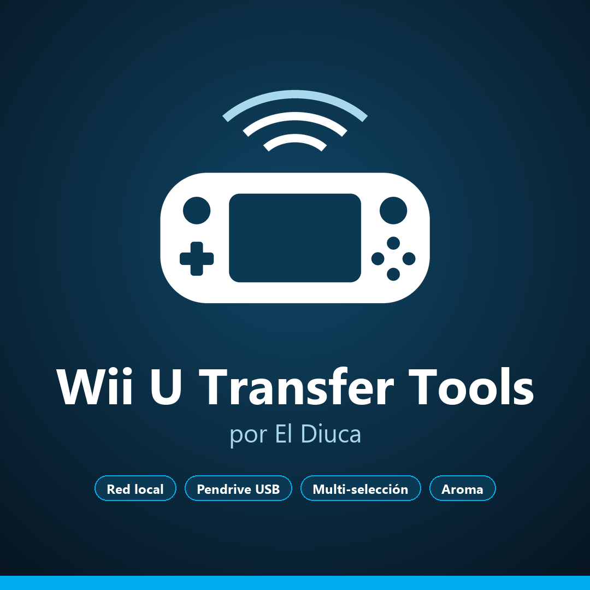
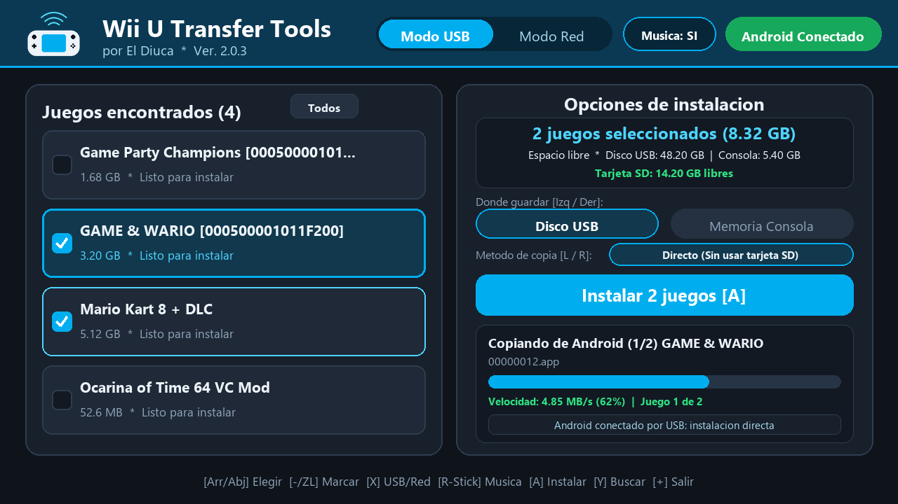
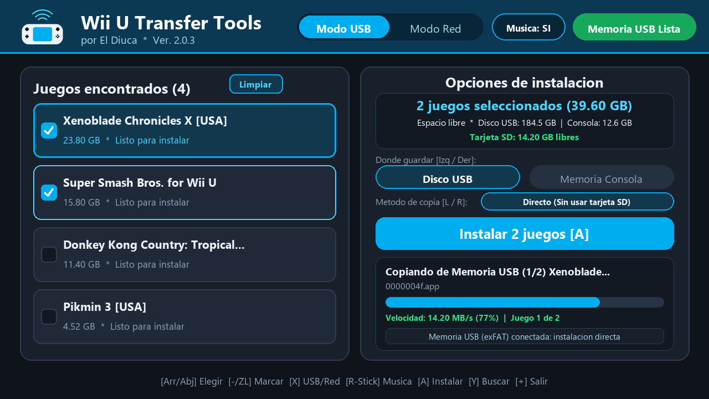
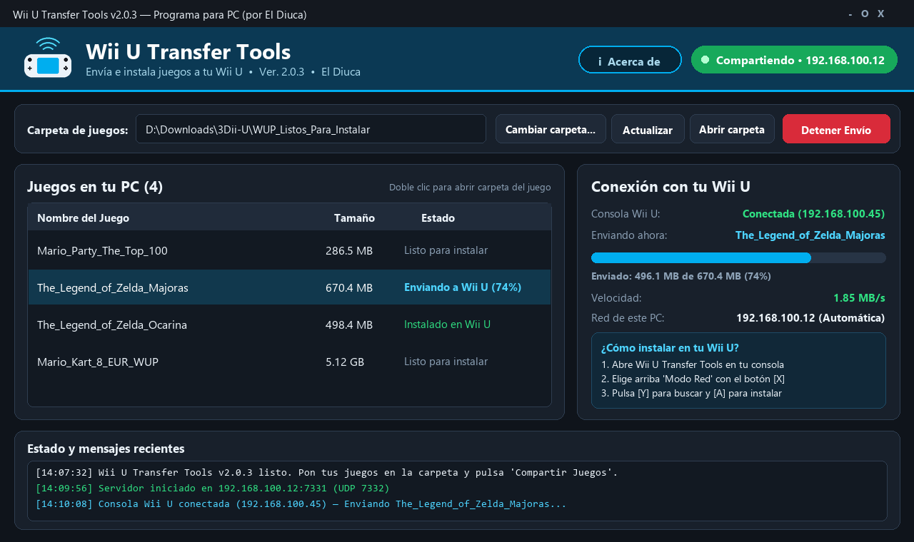
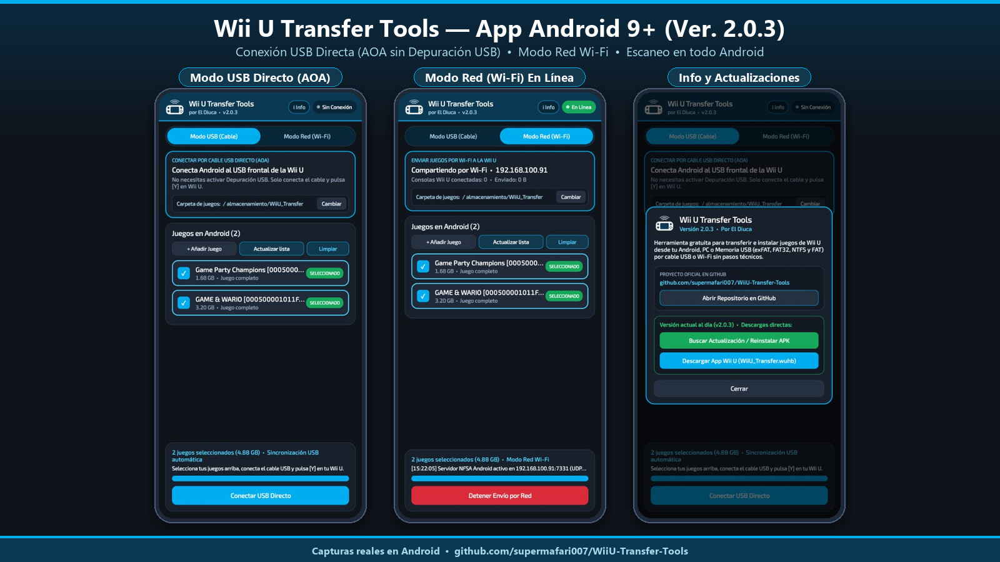

# Wii U Transfer Tools

  
  &nbsp;
  
  &nbsp;
  

  

Desarrollado por **El Diuca**.

**Versión 2.0.4** — Aplicación para consola Wii U (`.wuhb`), Plugin Aroma auto-actualizador (`.wps`), Aplicación para Android 9+ (`.apk`) e **Instalador único `.EXE` para Windows** con desinstalador integrado.

**Wii U Transfer Tools** permite transferir e instalar juegos y aplicaciones WUP de cualquier tamaño en tu Wii U (Aroma) **sin necesitar espacio en tu tarjeta SD**, directamente desde una **Memoria USB (`exFAT`, `FAT32`, `NTFS` o `FAT`)**, desde tu dispositivo **Android** (por cable USB directo AOA sin Depuración USB o por Wi-Fi) o desde tu **PC con Windows** (por Wi-Fi o adaptador de red LAN USB).

Este proyecto es **software de código abierto bajo la licencia MIT**. Consulta [LICENSE](LICENSE) para conocer los términos de uso, modificación y redistribución.

## Así se ve Wii U Transfer Tools

| En la consola Wii U (`Modo USB` / `Modo Red`) | Instalación desde Memoria USB (`exFAT`/`NTFS`/`FAT32`) |
|:---:|:---:|
|  |  |

| Programa para PC Windows | App para Android 9+ (USB Directo AOA y Wi-Fi) |
|:---:|:---:|
|  |  |

## Descargar la versión 2.0.4

* **Pack Completo Todo-en-Uno (`.ZIP` con instructivo ES/EN):** [WiiU_Transfer_Tools_Pack_Completo_v2.0.4.zip](https://github.com/supermafari007/WiiU-Transfer-Tools/releases/download/v2.0.4/WiiU_Transfer_Tools_Pack_Completo_v2.0.4.zip) — incluye la estructura lista para copiar a la SD (`wiiu/apps/WiiU_Transfer.wuhb` + plugin Aroma `WiiU_Transfer_Updater.wps`), el instalador de PC Windows, el `.apk` de Android e instructivo en Español e Inglés.
* **Wii U (Aroma):** [WiiU_Transfer.wuhb](https://github.com/supermafari007/WiiU-Transfer-Tools/releases/download/v2.0.4/WiiU_Transfer.wuhb) — copiar en `sd:/wiiu/apps/WiiU_Transfer.wuhb`.
* **Plugin Auto-Actualizador Aroma (Opcional recomendado):** [WiiU_Transfer_Updater.wps](https://github.com/supermafari007/WiiU-Transfer-Tools/releases/download/v2.0.4/WiiU_Transfer_Updater.wps) — copiar en `sd:/wiiu/environments/aroma/plugins/WiiU_Transfer_Updater.wps`. Comprueba GitHub en segundo plano al iniciar Aroma (detecta incluso versiones antiguas como `v1.0.0`) y aplica automáticamente las actualizaciones enviadas desde Android o PC cuando la app está cerrada.
* **PC (Windows 10/11 — Instalador único `.EXE`):** [WiiU_Transfer_Tools_Setup_v2.0.4.exe](https://github.com/supermafari007/WiiU-Transfer-Tools/releases/download/v2.0.4/WiiU_Transfer_Tools_Setup_v2.0.4.exe) — instalación limpia sin consolas visibles, bilingüe automático (ES/EN) y desinstalador completo.
* **Android (Android 9.0 o superior):** [WiiU_Transfer_Tools_Android.apk](https://github.com/supermafari007/WiiU-Transfer-Tools/releases/download/v2.0.4/WiiU_Transfer_Tools_Android.apk) — conexión USB directa AOA sin Depuración USB, lectura de juegos desde cualquier carpeta de Android, bilingüe automático (ES/EN) y envío de actualizaciones `.wuhb` directo a la SD de la Wii U.

## Novedades de la Versión 2.0.4

* **Soporte Bilingüe Autónomo (Español / Inglés) en las 3 Plataformas:**
  * Detecta automáticamente el idioma configurado en tu consola **Wii U** (`UCReadSysConfig`), **Windows** (`GetUserDefaultUILanguage`) y **Android** (`Locale`). Si el sistema está en Español abre en Español; en cualquier otro idioma abre en Inglés.
  * Incluye un **botón sutil de idioma (`ES | en` / `EN`)** en la cabecera de Wii U (táctil o `[L-Stick]`), PC Windows y Android para cambiar el idioma al instante sin reiniciar, guardando tu preferencia.
* **Modo USB seleccionado por defecto al abrir en Wii U:**
  * Al iniciar `WiiU_Transfer.wuhb`, la consola ahora arranca directamente en **`Modo USB`** listo para tu Memoria USB o dispositivo Android (puedes cambiar a **`Modo Red`** en cualquier momento con `[X]`).
* **Plugin Aroma con verificación exacta de versión y tamaño:**
  * `WiiU_Transfer_Updater.wps` verifica `version.json` y el tamaño real vía HTTP `HEAD`, detectando automáticamente instalaciones antiguas (incluso `v1.0.0`) para actualizarlas en segundo plano desde el Menú Wii U.

## Novedades de la Versión 2.0.3

* **Conexión USB directa Android (AOA — *Android Open Accessory*):** Canal USB binario directo sin necesidad de activar Depuración USB, con soporte para juegos grandes de hasta ~25 GB y colas de múltiples juegos.
* **Carga de juegos desde cualquier ubicación en Android y Memoria USB:** Escaneo recursivo automático en todo el almacenamiento de Android y en Memorias USB (`exFAT`, `FAT32`, `NTFS`, `FAT` — MBR y GPT).
* **Actualización directa de `WiiU_Transfer.wuhb` en la SD de la Wii U desde Android y PC:** Al pulsar *Descargar App Wii U (.wuhb)* envía el archivo directo a la SD de la consola por USB AOA o Wi-Fi.

## Estructura del proyecto

* **`Wii U/`** —
  * [WiiU_Transfer.wuhb](<Wii U/WiiU_Transfer.wuhb>): Aplicación compilada para **Aroma** (`sd:/wiiu/apps/WiiU_Transfer.wuhb`).
  * [WiiU_Transfer_Updater.wps](<Wii U/WiiU_Transfer_Updater.wps>): Plugin Aroma auto-actualizador (`sd:/wiiu/environments/aroma/plugins/WiiU_Transfer_Updater.wps`).
  * Código fuente en [Wii U/frontend/source/](Wii%20U/frontend/source/) y [Wii U/aroma_updater_plugin/source/](Wii%20U/aroma_updater_plugin/source/).
* **`Android/`** —
  * [WiiU_Transfer_Tools_Android.apk](Android/WiiU_Transfer_Tools_Android.apk): Aplicación nativa para **Android 9.0 (API 28)+**.
  * Código fuente en [Android/app/src/main/java/com/eldiuca/wiiutransfer/](Android/app/src/main/java/com/eldiuca/wiiutransfer/).
* **`PC/`** —
  * [Instalar_WiiU_Transfer_Tools.py](PC/Instalar_WiiU_Transfer_Tools.py), [wiiu_transfer_gui.py](PC/wiiu_transfer_gui.py) y [transfer_server.py](PC/transfer_server.py).
* **`version.json`** — Manifiesto de versión consultado automáticamente por Wii U (plugin Aroma), Android y PC.

## Guía rápida de uso

1. **En tu consola Wii U (Aroma):**
   * Copia `WiiU_Transfer.wuhb` en `sd:/wiiu/apps/WiiU_Transfer.wuhb`.
   * *(Opcional recomendado)* Copia `WiiU_Transfer_Updater.wps` en `sd:/wiiu/environments/aroma/plugins/WiiU_Transfer_Updater.wps`.
2. **Desde Memoria USB (`exFAT`, `FAT32`, `NTFS` o `FAT`):**
   * Copia las carpetas de tus juegos WUP en tu Memoria USB y conéctala al **puerto USB frontal** de la Wii U.
   * Abre **Wii U Transfer Tools** (arranca en **`Modo USB`**), pulsa **`[Y]`**, elige destino y pulsa **`[A]`**. Retira la memoria USB antes de salir al Menú Wii U.
3. **Desde Android (Android 9+):**
   * Instala `WiiU_Transfer_Tools_Android.apk`.
   * **Por Cable USB (AOA, sin Depuración USB)**: Conecta Android al USB frontal de la Wii U, pulsa **`[Y]`** en la Wii U y toca *Aceptar* en el aviso USB de Android.
   * **Por Red Wi-Fi**: Cambia a **`Modo Red (Wi-Fi)`**, pulsa **`Compartir Juegos por Red`** y en tu Wii U cambia a **`Modo Red`** con **`[X]`** y pulsa **`[Y]`**.
4. **Desde PC Windows:**
   * Ejecuta `WiiU_Transfer_Tools_Setup_v2.0.4.exe`, elige tu carpeta de juegos WUP, pulsa **`Compartir Juegos`** y en tu Wii U cambia a **`Modo Red`** con **`[X]`** y pulsa **`[Y]`**.
