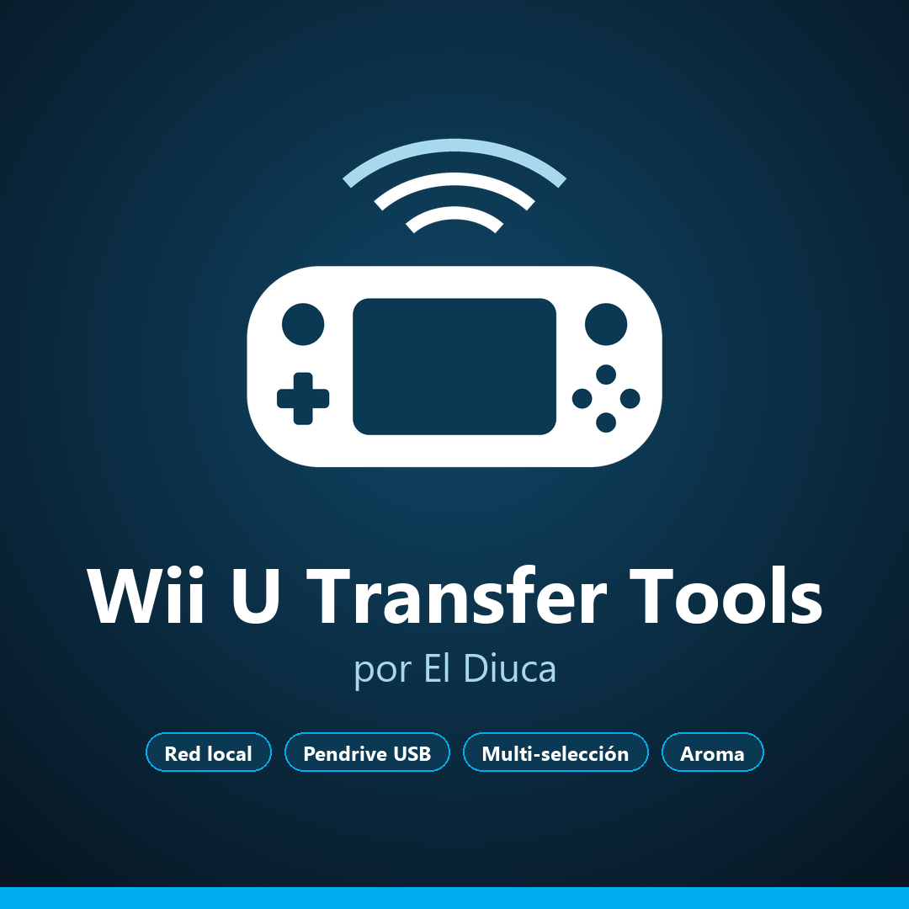
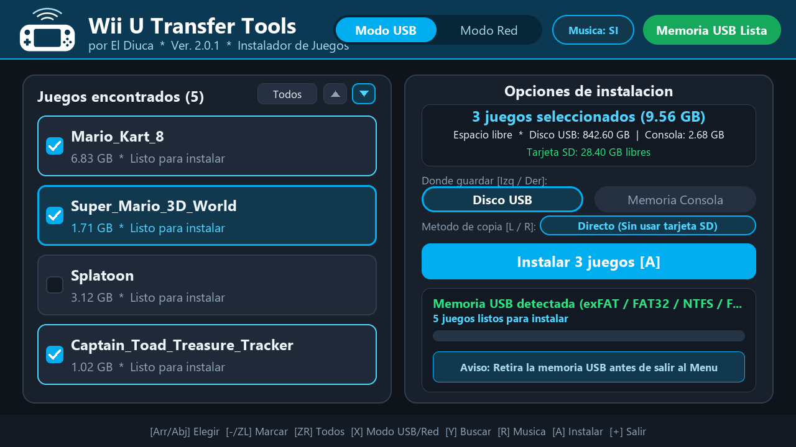
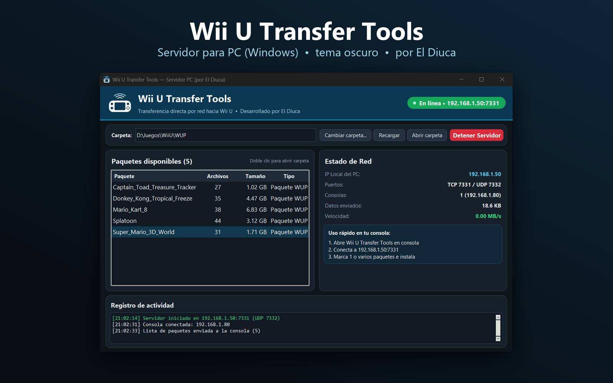
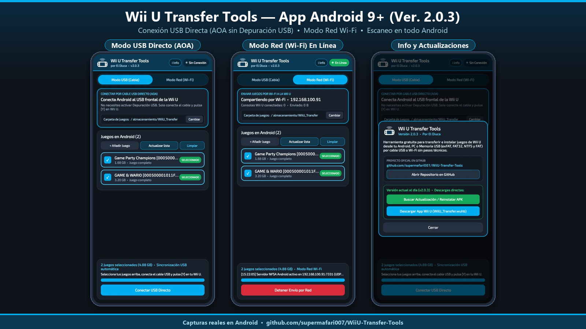

# Wii U Transfer Tools

  <a href="README.md">🇪🇸 Español</a> &nbsp;|&nbsp; <b>🇺🇸 English</b>

  

Developed by **El Diuca**.

**Version 2.0.4** — Wii U Console App (`.wuhb`), Aroma Auto-Updater Plugin (`.wps`), Android 9+ App (`.apk`), and **Standalone Windows `.EXE` Installer** with built-in uninstaller.

**Wii U Transfer Tools** lets you transfer and install WUP games and apps of any size on your Wii U (Aroma) **without needing free space on your SD card**, directly from a **USB Drive (`exFAT`, `FAT32`, `NTFS`, or `FAT`)**, your **Android device** (via direct AOA USB cable with no USB Debugging required, or over Wi-Fi), or your **Windows PC** (over Wi-Fi or USB LAN Ethernet adapter).

This project is **open-source software licensed under the MIT License**. See [LICENSE](LICENSE) for full terms.

## Preview

| Wii U Console (`USB Mode` / `Net Mode`) | Windows PC App |
|:---:|:---:|
|  |  |

  

## Download Version 2.0.4

* **All-in-One Complete Pack (`.ZIP` with ES/EN guide):** [WiiU_Transfer_Tools_Pack_Completo_v2.0.4.zip](https://github.com/supermafari007/WiiU-Transfer-Tools/releases/download/v2.0.4/WiiU_Transfer_Tools_Pack_Completo_v2.0.4.zip) — includes the ready-to-copy SD card structure (`wiiu/apps/WiiU_Transfer.wuhb` + Aroma plugin `WiiU_Transfer_Updater.wps`), Windows PC Setup `.exe`, Android `.apk`, and bilingual instructions.
* **Wii U (Aroma):** [WiiU_Transfer.wuhb](https://github.com/supermafari007/WiiU-Transfer-Tools/releases/download/v2.0.4/WiiU_Transfer.wuhb) — copy to `sd:/wiiu/apps/WiiU_Transfer.wuhb`.
* **Aroma Auto-Updater Plugin (Recommended optional):** [WiiU_Transfer_Updater.wps](https://github.com/supermafari007/WiiU-Transfer-Tools/releases/download/v2.0.4/WiiU_Transfer_Updater.wps) — copy to `sd:/wiiu/environments/aroma/plugins/WiiU_Transfer_Updater.wps`. Automatically checks GitHub in the background on Wii U Menu boot (even detecting old versions like `v1.0.0`) and applies staged updates sent from Android or PC when the app is closed.
* **PC (Windows 10/11 — Standalone `.EXE` Setup):** [WiiU_Transfer_Tools_Setup_v2.0.4.exe](https://github.com/supermafari007/WiiU-Transfer-Tools/releases/download/v2.0.4/WiiU_Transfer_Tools_Setup_v2.0.4.exe) — silent GUI installation, automatic ES/EN language detection, and full uninstaller.
* **Android (Android 9.0 or higher):** [WiiU_Transfer_Tools_Android.apk](https://github.com/supermafari007/WiiU-Transfer-Tools/releases/download/v2.0.4/WiiU_Transfer_Tools_Android.apk) — direct AOA USB cable transfer (no USB Debugging needed), full-device game scanning, automatic ES/EN language detection, and direct `.wuhb` SD updates.

## What's New in Version 2.0.4

* **Autonomous Bilingual Support (Spanish / English) on All 3 Platforms:**
  * Automatically detects the system language on **Wii U** (`UCReadSysConfig`), **Windows** (`GetUserDefaultUILanguage`), and **Android** (`Locale`). Spanish systems launch in Spanish; all other locales launch in English.
  * Includes a subtle **`EN | es` / `EN` language pill** in the header of Wii U (touch or `[L-Stick]`), Windows PC, and Android to switch languages live without restarting, remembering your preference.
* **USB Mode Selected by Default on Wii U:**
  * `WiiU_Transfer.wuhb` now boots directly into **`USB Mode`** ready for your USB Drive or Android device (press `[X]` anytime to switch to **`Net Mode`**).
* **Aroma Plugin Exact Version & Size Verification:**
  * `WiiU_Transfer_Updater.wps` verifies both `version.json` and the exact remote file size via HTTP `HEAD`, automatically detecting outdated installs (including `v1.0.0`) and replacing them in the background from the Wii U Menu.

## Key Features

* **Zero SD Space Required:** Streams games directly into Wii U USB Storage or Console NAND via Mocha FSA, or optionally uses a temporary SD cache (`[L / R]`).
* **Multi-Format USB Drive Reader (`exFAT`, `FAT32`, `NTFS`, `FAT` — MBR & GPT):** No FAT32 formatting or 4 GB file limit required; supports recursive folder scanning and large games (~25 GB+) in multi-game queues.
* **Direct Android USB (AOA — *Android Open Accessory*):** Plug-and-play USB cable transfers without enabling USB Debugging, plus full Wi-Fi network mode.
* **Fast Network Mode (Wi-Fi & USB LAN Ethernet):** Optimized `somemopt` TCP pipeline for both Windows PC and Android servers.

## Project Structure

* **`Wii U/`** —
  * [WiiU_Transfer.wuhb](<Wii U/WiiU_Transfer.wuhb>): Compiled **Aroma** app (`sd:/wiiu/apps/WiiU_Transfer.wuhb`).
  * [WiiU_Transfer_Updater.wps](<Wii U/WiiU_Transfer_Updater.wps>): Aroma background auto-updater plugin (`sd:/wiiu/environments/aroma/plugins/WiiU_Transfer_Updater.wps`).
  * Source code in [Wii U/frontend/source/](Wii%20U/frontend/source/) and [Wii U/aroma_updater_plugin/source/](Wii%20U/aroma_updater_plugin/source/).
* **`Android/`** —
  * [WiiU_Transfer_Tools_Android.apk](Android/WiiU_Transfer_Tools_Android.apk): Native app for **Android 9.0 (API 28)+**.
  * Source code in [Android/app/src/main/java/com/eldiuca/wiiutransfer/](Android/app/src/main/java/com/eldiuca/wiiutransfer/).
* **`PC/`** —
  * [Instalar_WiiU_Transfer_Tools.py](PC/Instalar_WiiU_Transfer_Tools.py), [wiiu_transfer_gui.py](PC/wiiu_transfer_gui.py), and [transfer_server.py](PC/transfer_server.py).
* **`version.json`** — Version manifest checked automatically by the Aroma plugin, Android app, and PC app.

## Quick Start Guide

1. **On your Wii U (Aroma):**
   * Copy `WiiU_Transfer.wuhb` to `sd:/wiiu/apps/WiiU_Transfer.wuhb`.
   * *(Optional recommended)* Copy `WiiU_Transfer_Updater.wps` to `sd:/wiiu/environments/aroma/plugins/WiiU_Transfer_Updater.wps`.
2. **From a USB Drive (`exFAT`, `FAT32`, `NTFS`, or `FAT`):**
   * Copy your WUP game folders onto your USB Drive and plug it into the **front USB port** of your Wii U.
   * Open **Wii U Transfer Tools** (starts in **`USB Mode`**), press **`[Y]`**, choose your target storage, and press **`[A]`**. Unplug the USB Drive before returning to the Wii U Menu.
3. **From Android (Android 9+):**
   * Install `WiiU_Transfer_Tools_Android.apk`.
   * **Via USB Cable (AOA, no USB Debugging):** Connect Android to the Wii U front USB port, press **`[Y]`** on Wii U, and tap *OK* on the Android USB accessory prompt.
   * **Via Wi-Fi:** Switch to **`Network Mode (Wi-Fi)`**, tap **`Share Games over Wi-Fi`**, then switch your Wii U to **`Net Mode`** with **`[X]`** and press **`[Y]`**.
4. **From Windows PC:**
   * Run `WiiU_Transfer_Tools_Setup_v2.0.4.exe`, select your WUP games folder, click **`Share Games`**, then switch your Wii U to **`Net Mode`** with **`[X]`** and press **`[Y]`**.
